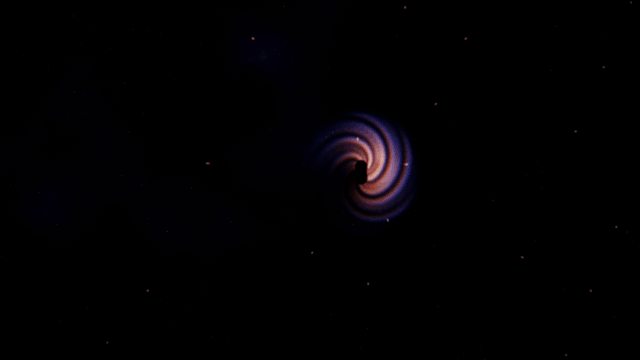
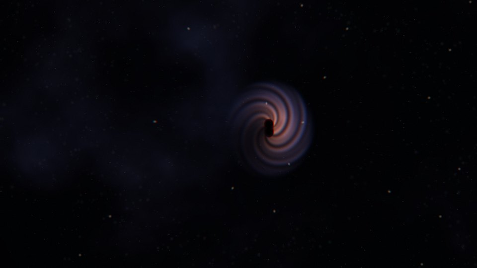
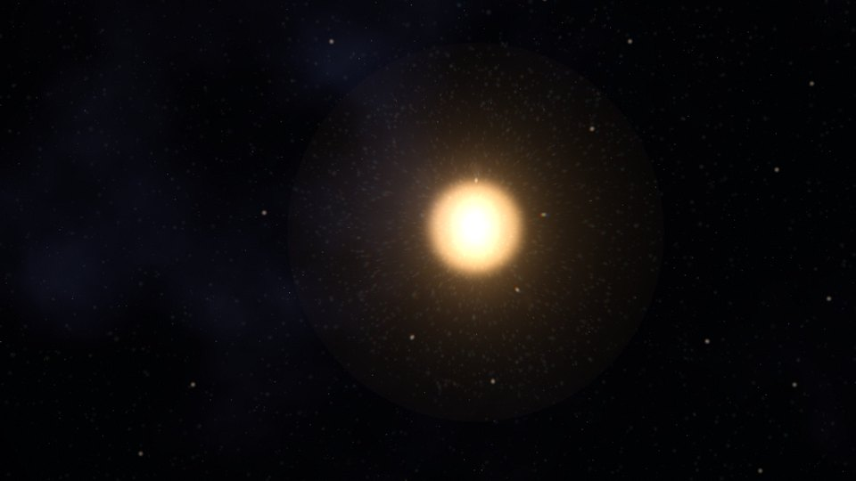
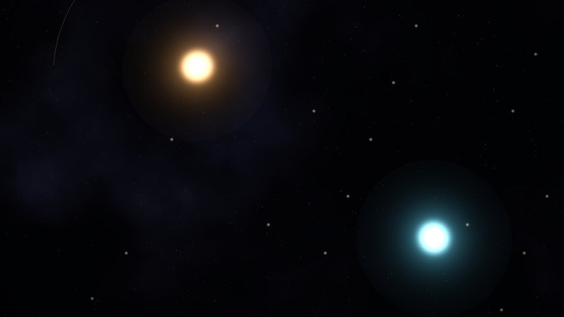
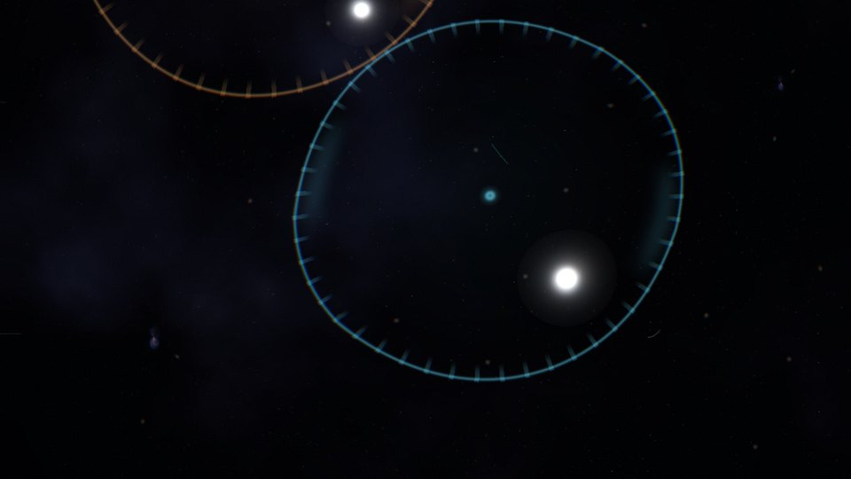
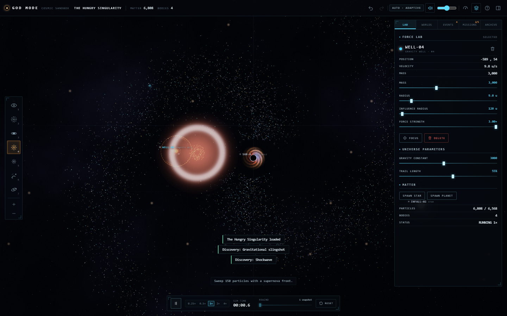

<p align="center">
  <a href="https://event-horizon-teal.vercel.app"></a>
</p>

<p align="center">
  <em>Bend gravity. Shape orbits. Trigger supernovas.<br>Explore a universe in motion — and see what happens when you disturb it.</em>
</p>

<p align="center">
  <a href="https://event-horizon-teal.vercel.app"></a>
  &nbsp;
  <a href="https://github.com/aspire488/event-horizon"></a>
</p>

<p align="center">
  <sub>Interactive WebGL experience · runs in your browser · no account or backend required · <a href="https://event-horizon-teal.vercel.app">event-horizon-teal.vercel.app</a></sub>
</p>

<br>

<p align="center">
  <a href="https://event-horizon-teal.vercel.app"></a>
  <br>
  <sub><b>Captured from the live application.</b> In <i>The Hungry Singularity</i>, matter is painted toward the accretion disc before a nearby supernova sends a shockwave through the scene.</sub>
</p>

## A universe in your hands

Event Horizon is an interactive cosmic physics sandbox built around one simple idea: give people the tools to disturb a universe, then let gravity tell the rest of the story.

Drop a black hole into a spiral galaxy. Redirect a stream of matter. Launch a planet into orbit or detonate a star. Watch particles scatter, objects interact, and discoveries emerge from the simulation.

This is more than a space-themed screensaver. The simulation advances on a fixed clock, independently of rendering, with reproducible starting worlds and tools to pause, rewind, undo, checkpoint, save, and revisit experiments. Its discovery system detects meaningful events as they happen, including stable orbits, event-horizon captures, merges, shockwaves, and gravitational slingshots.

> The application currently displays the in-app title **GOD MODE**. Event Horizon is the public project name for that same application.

## Seven tools. One universe.

| Key | Tool | What you can do |
| :-: | --- | --- |
| `1` | **Observe** | Inspect bodies, select them, move them, and navigate the field. |
| `2` | **Gravity** | Place and tune a gravity well to bend nearby trajectories. |
| `3` | **Black Hole** | Create a singularity and watch matter approach and cross its event horizon. |
| `4` | **Supernova** | Detonate a star and send an expanding shockwave through the system. |
| `5` | **Repel** | Place a repulsor and push matter away from its influence. |
| `6` | **Paint** | Stream particles into the universe; stroke speed affects how quickly matter is emitted. |
| `7` | **Orbit** | Launch a body into an orbit around the nearest mass. |

The Force Lab exposes the selected tool's parameters. Tune the gravitational constant and trail length to change how the universe behaves and how its motion is displayed.

## Six starting worlds

Each world is a reproducible starting point generated from a fixed seed. Choose a setup, experiment, and return to the same initial conditions whenever you want.

<table>
<tr>
<td width="50%" valign="top">

<br><b>The Hungry Singularity</b><br><sub>A black hole and its swirling accretion disc. Send matter inward and watch the encounter unfold.</sub>
</td>
<td width="50%" valign="top">

<br><b>Stellar Collapse</b><br><sub>A dense stellar environment poised for a dramatic release of energy.</sub>
</td>
</tr>
<tr>
<td width="50%" valign="top">

<br><b>Binary Dance</b><br><sub>Two stars in a mutual orbit, surrounded by drifting matter.</sub>
</td>
<td width="50%" valign="top">

<br><b>Total Chaos</b><br><sub>Singularities, stars, and a repulsor sharing one unpredictable field.</sub>
</td>
</tr>
</table>

The atlas also includes **Prime Field**, a spiral galaxy with a binary companion and three planets, and **Slingshot**, a high-velocity encounter shaped by a massive star's gravity.

<sub>These are frames captured from the production application, cropped with the interface hidden. The wordmark above is decorative artwork.</sub>

## Inside the observatory

<p align="center">
  
  <br>
  <sub>The full instrument: tool rail, Force Lab, discovery feed, simulation transport, rewind, and reset.</sub>
</p>

- **Control time.** Pause and resume, change simulation speed, rewind through captured states, create checkpoints, and undo or redo experiments.
- **Follow discoveries.** Objectives and the live event feed surface detected events such as stable orbits, event-horizon captures, merges, shockwaves, and gravitational slingshots.
- **Keep your experiments.** Store up to eight local saves, rename them, export JSON, and import validated experiments. Saves remain in your browser.
- **Hear the universe.** Procedural audio responds to the simulation with ambient layers and event sounds. Mute it whenever you like.
- **Choose your visual quality.** Cinematic, Balanced, Performance, and adaptive Auto quality options tune rendering without changing the underlying particle simulation.

## Built as an instrument

Event Horizon combines a deterministic simulation core with a real-time Three.js/WebGL renderer. The visual language is designed around the physics: a black hole's photon ring and limb-darkened photosphere, Doppler-shifted accretion-disc lighting, stellar diffraction spikes, additive particle trails, shockwaves, and a world-anchored graticule that scales as you navigate.

The engineering is just as deliberate:

- **Fixed-step physics:** a 1/60-second simulation step keeps physics independent of display frame rate.
- **Stable numerical behavior:** semi-implicit integration, Newtonian gravity with Plummer softening, and bounded acceleration and speed.
- **Deterministic particle recycling:** particle storage is bounded, with a 24,000-particle ceiling.
- **Two-phase slingshot detection:** a flyby is armed on inbound motion and counted only after outbound escape, avoiding false discoveries during scenario loading.
- **Rendering-only quality tiers:** visual quality changes do not trim or otherwise mutate the simulation's target particle population.
- **Adaptive Auto quality:** a measured P95 frame-time controller adjusts rendering quality with hysteresis and cooldown to avoid rapid oscillation.
- **Event-driven effects:** merges, captures, stellar collapse, supernova shockwaves, and other simulation events drive visual and audio feedback.

The black-hole and relativistic-looking effects are visual approximations layered over the simulation; this is an interactive sandbox, not a general-purpose relativistic astrophysics solver.

<details>
<summary><b>Architecture and source layout</b></summary>
<br>

The application is a Vite and TypeScript single-page app. The physics core is independent of the Three.js/WebGL renderer; `src/app.ts` coordinates simulation, rendering, input, history, and persistence.

```text
src/core/    physics, particles, worlds, scenarios, events, objectives, history, serialization
src/render/  Three.js renderer, shaders, camera
src/input/   pointer, mouse, and touch interactions
src/ui/      panels, controls, help, notifications
src/audio/   procedural Web Audio
src/app.ts   application orchestration
```

</details>

## Run it locally

Requires Node.js 20.19 or newer and npm.

```sh
npm ci
npm run dev
```

Open the local URL printed by Vite (normally `http://localhost:5173`).

Build and preview the production bundle:

```sh
npm run build
npm run preview
```

## Controls

| Input | Action |
| --- | --- |
| `1`–`7` | Select Observe, Gravity, Black Hole, Supernova, Repel, Paint, or Orbit |
| Left click / drag | Use the selected tool; drag selected bodies to move them |
| Left drag on empty space with Observe | Pan the camera |
| Right / middle drag | Pan with any tool |
| Wheel / pinch | Zoom |
| `Z` / `Y` (`Ctrl+Z` / `Ctrl+Shift+Z`) | Undo / redo |
| `Space` | Pause / resume |
| `+` / `-` | Change simulation speed |
| `F` / `Delete` / `R` | Focus selection / delete selection / reset world |
| `M` / `P` / `L` / `H` | Mute / performance display / labels / hide interface |
| `?` | Open the help overlay |

On touch devices, tap and drag to use tools, use two fingers to pan, and pinch to zoom. The panel toggle keeps controls reachable on smaller screens.

**Accessibility and comfort.** The application responds to `prefers-reduced-motion`, provides visible keyboard focus, and labels toolbar and transport controls for assistive technology. Sound can be muted with `M` or the volume control. The Performance and Auto quality options help adapt rendering to available hardware.

## Performance and benchmarks

The release benchmark was measured on an **RTX 3050 Laptop GPU (6 GB)** using **ANGLE over Vulkan**, at **1280×800**. The recorded final run reported:

| Metric | Result |
| --- | ---: |
| P50 frame time | 6.9 ms |
| P95 frame time | 7.0 ms |
| P99 frame time | 7.1 ms |
| Worst frame time | 7.1 ms |
| Reported frame rate | 144.1 FPS |

These measurements were display-refresh-bound at 144 Hz; they do not establish maximum GPU throughput. The benchmark report documents the methodology, quality tiers, environment, and limitations. See [`docs/BENCHMARKS.md`](docs/BENCHMARKS.md).

## Tests and release verification

The latest release verification recorded:

| Check | Result |
| --- | ---: |
| Unit tests (Vitest) | **65/65 passed** |
| Local browser smoke | **18/18 passed** |
| Production browser smoke | **18/18 passed** |
| QA smoke | **6/6 passed** |
| Seeded campaign personas | **10/10 passed** |
| Campaign fuzz cases | **100/100 passed** |
| User acceptance checks | **12/12 passed** |
| Extended session | **600.8 seconds** |

Typecheck and production build completed cleanly. The extended acceptance session reported no console errors, uncaught exceptions, or failed network requests.

Run the core checks locally:

```sh
npm run typecheck
npm test
npm run build
```

<details>
<summary><b>Verification scope and limitations</b></summary>
<br>

The release campaign exercised seeded scenarios, tool interactions, quality switching, save/restore, responsive layouts, focus behavior, and an extended session. The campaign is seeded and finite, not an exhaustive proof of correctness.

The RTX 3050 benchmark is refresh-bound at the tested resolution; higher-resolution GPU-bound benchmarking remains useful future work. Automated audio checks validate code paths, not subjective sound quality through physical speakers. Touch emulation does not replace testing on physical touch hardware. Browser zoom edge cases and WebGL context-loss recovery have not been fully verified.

Detailed benchmark methodology and defect history are retained in `docs/BENCHMARKS.md` and `docs/DEFECTS.md`.

</details>

## Deploy to Vercel

Event Horizon is a static Vite application. Use the Vite preset, `npm ci` for installation, `npm run build` as the build command, and `dist` as the output directory. No backend or environment variables are required.

Production: [event-horizon-teal.vercel.app](https://event-horizon-teal.vercel.app).

## Contributing

Bug reports and ideas are welcome through [GitHub Issues](https://github.com/aspire488/event-horizon/issues). Before opening a pull request, describe the proposed change and run the relevant typecheck, test, and build commands. Include screenshots for visual changes and benchmark evidence for performance-sensitive changes.

## License

Event Horizon is licensed under the [MIT License](LICENSE). You may use, modify, and distribute the software under its terms; retain the copyright and license notice in copies or substantial portions of the software.

<br>

<p align="center">
  <a href="https://event-horizon-teal.vercel.app"><b>Enter the universe →</b></a>
</p>
