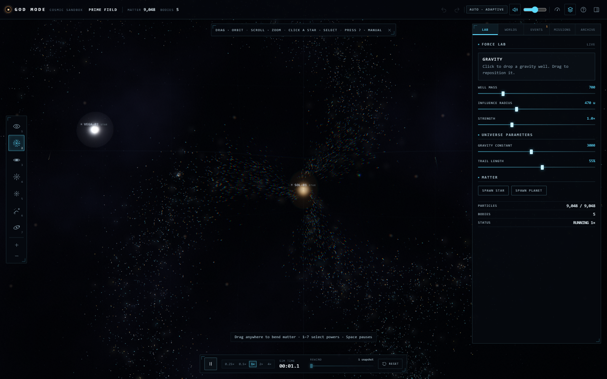

# EVENT HORIZON

An interactive cosmic physics sandbox where you manipulate gravity, black holes, supernovas, and orbital systems in a living universe. The existing in-app label remains GOD MODE.

** Live Demo:** [event-horizon-teal.vercel.app](https://event-horizon-teal.vercel.app)



## Features

- Seven tools: Observe, Gravity, Black Hole, Supernova, Repel, Paint, and Orbit.
- Six seeded worlds, a live event feed, and five discovery objectives.
- Fixed-step particle and body simulation, shockwaves, captures, merges, and stellar collapse.
- Pause, speed controls, undo/redo, checkpoints, snapshot rewind, and reset.
- Local experiment save/load, rename, export, and validated JSON import.
- Procedural WebGL visuals and Web Audio effects, with quality and reduced-motion controls.

## Run locally

Requires Node.js 20.19 or newer and npm. Install the exact dependency tree from the lockfile:

```sh
npm ci
npm run dev
```

Open the URL Vite prints (normally `http://localhost:5173`).

Build and preview the production bundle:

```sh
npm run build
npm run preview
```

Preview runs at `http://localhost:4173`.

## Controls

| Input | Action |
| --- | --- |
| `1`–`7` | Select Observe, Gravity, Black Hole, Supernova, Repel, Paint, Orbit |
| Left click / drag | Use the selected tool; drag selected bodies to move them |
| Left drag on empty space with Observe | Pan the camera |
| Right / middle drag | Pan with any tool |
| Wheel / pinch | Zoom |
| `Z` / `Y` (`Ctrl+Z` / `Ctrl+Shift+Z`) | Undo / redo |
| `Space` | Pause / resume |
| `+` / `-` | Change simulation speed |
| `F` / `Delete` / `R` | Focus selection / delete selection / reset world |
| `M` / `P` / `L` / `H` | Mute / performance display / labels / hide interface |
| `?` | Open the help overlay |

Touch users can tap and drag tools, pan with two fingers, pinch to zoom, and use the panel toggle to reach controls.

## Architecture

The app is a Vite and TypeScript single-page application with a Three.js/WebGL renderer. The physics core is separated from rendering and uses a fixed-step accumulator, semi-implicit integration, softened gravity, bounded particle storage, and deterministic scenario seeds. The UI is DOM-based; `src/app.ts` coordinates simulation, rendering, history, input, and persistence.

```text
src/core/    physics, particles, worlds, scenarios, events, objectives, history, serialization
src/render/  Three.js renderer, shaders, camera
src/input/   mouse, pointer, and touch tool interactions
src/ui/      panels, controls, help, notifications
src/audio/   procedural Web Audio
src/app.ts   application orchestration
```

## Tests and release checks

```sh
npm run typecheck
npm test
npm run build
npm run preview   # terminal 1
npm run smoke     # terminal 2; set CHROME_PATH if needed
```

The current recorded results are 46 unit tests and 18 production-browser smoke checks passing. The smoke suite exercises the declared favicon, rendering, tools, worlds, history, save/reload, JSON export/import and malformed-import rejection. The separate user acceptance pass covered all six requested viewport sizes, all six worlds and seven tools, isolated save/restore flows, touch emulation, and a 10-minute session. The current lockfile install reported zero known npm advisories during release verification. Reports and screenshots are retained in `scripts/` and `artifacts/user-acceptance/`.

The browser checks use headless Chromium with SwiftShader software WebGL in this environment. Those FPS readings do not measure physical GPU performance. Physical touch hardware, browser zoom edge cases, and WebGL context-loss recovery have not been fully verified.

## Deploy to Vercel

This is a static Vite app. Import the repository in Vercel and use the Vite preset, `npm ci` for installation, `npm run build` as the build command, and `dist` as the output directory. No backend or environment variables are required. The project does not use client-side URL routes, so no SPA rewrite is needed.

Production deployment: [event-horizon-teal.vercel.app](https://event-horizon-teal.vercel.app).

## License

No open-source license has been selected or included. Licensing and redistribution terms remain to be decided.
